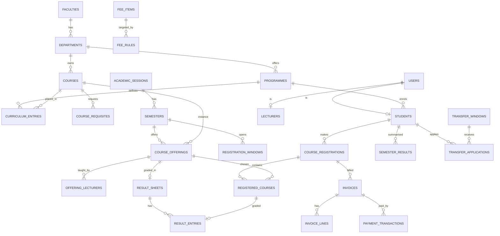

# 05 — Architecture

**Style:** Modular monolith; domain-oriented core plus pluggable modules
**Runtime:** PHP 8.3+ · Laravel 13 · MySQL 8 · Blade/Bootstrap 5.3 · Vite
**Status:** Draft v1.0 · 26 September 2026

---

## 1. Architectural drivers

| Driver | Consequence |
|---|---|
| Five portals with hierarchical scope | One `users` table with `type` + org scope columns; per-portal route files, middleware and layouts; a central **scope layer** applied to every query |
| Registration-day spikes | Eligibility pre-computation, cached catalogue/curriculum, queued invoices/PDFs, windows staggered by level |
| Money and results integrity | Actions + state machines + DB transactions + row locks + snapshots + maker-checker + audit |
| Shared hosting as a target | Every infra dependency optional (DB queue via cron, file/DB cache, pure-PHP PDF) |
| Extensibility | `nwidart/laravel-modules` with stable extension points; core never depends on modules |

## 2. Layers
```
HTTP (portal controllers, FormRequests, middleware)  → thin
Application (Actions: one use case each, transactional, emit events)
Domain (Models, Enums, State machines, Rules engines: Registration, Prerequisite, Fee, Grading, Transfer eligibility)
Infrastructure (Payment drivers, PDF renderer, Importers/Exporters, Storage, Mail)
```
Rules: no business logic in controllers or Blade; side effects via queued listeners dispatched after commit; money is integer kobo in a `Money` value object; every status column is a backed enum.

## 3. Directory structure
```
app/
├── Actions/
│   ├── Accounts/        CreateFacultyAdmin, CreateDepartmentAdmin, CreateLecturer, ActivateStudent
│   ├── Academics/       SetCurrentSession, CreateCourse, SyncCurriculum, GenerateOfferings, AllocateLecturer
│   ├── Students/        CreateStudent, ImportStudents, GenerateMatricNumber, PromoteStudents
│   ├── Registration/    OpenWindow, CloseWindow, StartRegistration, AddCourse, RemoveCourse,
│   │                    SubmitRegistration, ApproveRegistration, ReturnRegistration, AmendRegistration,
│   │                    GrantPrerequisiteWaiver, RequestOverload, DecideOverload
│   ├── Billing/         BuildInvoice, IssueSupplementaryInvoice, IssueCreditNote, AddAdhocCharge
│   ├── Payments/        InitiatePayment, VerifyPayment, ConfirmManualPayment
│   ├── Results/         SaveScores, ImportScores, SubmitResultSheet, ApproveResultSheet, ReturnResultSheet,
│   │                    PublishResults, RequestAmendment, ComputeStudentGpa
│   ├── Transfers/       OpenTransferWindow, ApplyForTransfer, DecideTransferStage, EffectTransfer
│   └── Documents/       GenerateCourseForm, GenerateReceipt, GenerateStatementOfResult
├── Domain/
│   ├── Registration/    EligibleCourseResolver, CarryOverResolver, PrerequisiteChecker, UnitLoadPolicy,
│   │                    RegistrationStateMachine, RegistrationValidator (collects RuleViolation[])
│   ├── Billing/         FeeRuleMatcher, CoursePricer (per_course|per_unit), InvoiceBuilder
│   ├── Results/         GradingScheme, GradeCalculator, GpaCalculator, AcademicStandingPolicy,
│   │                    ResultSheetStateMachine
│   ├── Transfers/       TransferEligibility, TransferStateMachine, PermissibleTransferMatrix
│   ├── Scoping/         OrgScope (value object), ScopeResolver, ScopedQuery (trait/macro)
│   └── Numbering/       SequenceGenerator (matric, invoice, form codes)
├── Enums/  Events/  Listeners/  Jobs/  Notifications/  Policies/  Models/
├── Http/
│   ├── Controllers/{Student,Lecturer,Department,Faculty,Admin,Public,Webhooks}/
│   ├── Middleware/      EnsurePortal:{type}, ApplyOrgScope, EnsureTwoFactor, ForcePasswordChange, IdleTimeout
│   └── Requests/…
├── Payments/            Contracts/PaymentGateway, Drivers/{Paystack,Flutterwave,Remita,Manual}, PaymentManager
├── Pdf/                 PdfRenderer (dompdf), templates in resources/views/pdf
├── Support/Extensibility/ MenuRegistry (per portal), DashboardWidgetRegistry (per portal), SettingsRegistry,
│                        PermissionRegistry, ReportRegistry
└── Settings/            GeneralSettings, RegistrationSettings, BillingSettings, ResultSettings, TransferSettings

Modules/CourseEvaluation/  (sample module, §8)

routes/  web.php (public, verify) · student.php · lecturer.php · department.php · faculty.php · admin.php · webhooks.php · console.php
resources/views/  layouts/{auth,student,staff,print} · student/ lecturer/ department/ faculty/ admin/ pdf/ components/
database/seeders/ Roles&Permissions, States&Lgas, GradingScheme(NUC), DegreeClasses, DemoUniversity(local)
tests/ Unit/{Registration,Billing,Results,Transfers,Scoping} Feature/{Student,Lecturer,Department,Faculty,Admin,Payments} Arch/
```

## 4. Identity, portals & scoping

### 4.1 Users and portals
- `users.type` ∈ `student`, `lecturer`, `department_admin`, `faculty_admin`, `super_admin`, `bursary`.
- One `web` session guard. Each portal's login controller authenticates only matching types (`PortalAuthenticator::attempt($portal, $credentials)`); mismatches return the generic "invalid credentials".
- Portal route groups: `Route::prefix('department')->middleware(['auth','portal:department','scope','2fa','idle'])`.
- Roles (spatie) add capability inside a portal: e.g. department sub-roles `hod`, `exam_officer`, `dept_officer`; lecturer flag `course_adviser` via `adviser_assignments`.

### 4.2 Org scope
`users.faculty_id`, `users.department_id` (nullable). `OrgScope` resolves to one of `All`, `Faculty(id)`, `Department(id)`, `Own(user)`.

```php
// Every scoped model implements ScopedByOrg and defines how it maps to a department/faculty
Student::query()->scopedTo($user->orgScope());      // where department_id in (...) etc.
Course::query()->scopedTo($scope);                  // by owning department
ResultSheet::query()->scopedTo($scope);             // via offering → course → department
```
- `ApplyOrgScope` middleware binds the current `OrgScope` in the container.
- Policies call `$scope->covers($model)` for single-record access (route model binding by UUID).
- **Arch test:** controllers under `Department/` and `Faculty/` must call `scopedTo` or go through a policy-checked binding (custom PHPStan rule + feature tests per model).

### 4.3 Account hierarchy invariants
- Only Super Admin creates `faculty_admin`. `CreateDepartmentAdmin` asserts that the target department belongs to the actor's faculty. `CreateLecturer` asserts the actor's department (or faculty).
- A user can manage only accounts strictly below them in their scope.

## 5. Data model

### 5.1 ERD


### 5.2 Tables (key columns; ★ = soft deletes; all have timestamps; user-facing rows have `uuid`)

**Identity & people**
| Table | Columns |
|---|---|
| `users` ★ | uuid, type enum, title, surname, first_name, other_names, email unique, phone unique, password, faculty_id null, department_id null, status enum(active, suspended), must_change_password, two_factor_* (encrypted), last_login_at/ip |
| `students` ★ | user_id unique, matric_no unique, programme_id, department_id, faculty_id (denormalised for scoping), entry_session_id, entry_level smallint, entry_mode enum(utme, de, transfer), current_level smallint, curriculum_version_id, status enum(active, deferred, suspended, withdrawn, graduated), is_spill_over bool, gender, dob, state_id, lga_id, nationality_country_id, address, next_of_kin JSON, passport_path, profile_locked_at, admitpro_application_no null, cgpa decimal(4,2) cached, standing enum |
| `lecturers` ★ | user_id unique, staff_id unique, department_id, rank, specialisation |
| `adviser_assignments` | lecturer_id, academic_session_id, department_id, level, programme_id null; unique(session, department, level, programme) |
| `states`, `lgas`, `countries` | reference data |

**Academic structure**
| Table | Columns |
|---|---|
| `academic_sessions` ★ | name unique, starts_on, ends_on, is_current |
| `semesters` ★ | academic_session_id, name, type enum(first, second, year), sequence, starts_on, ends_on; unique(session, type) |
| `calendar_events` | semester_id, title, starts_on, ends_on, category |
| `faculties` ★ | code unique, name, dean_name, is_active |
| `departments` ★ | faculty_id, code unique, name, is_service_unit bool, is_active |
| `programmes` ★ | uuid, department_id, code unique, name, award, duration_years, max_duration_years, mode, min_graduation_units, pricing_mode enum(per_course, per_unit), unit_rate_kobo null, olevel_requirements JSON (for transfers) |
| `level_unit_limits` | programme_id null (null = institution default), level, semester_type, min_units, max_units |
| `courses` ★ | uuid, department_id (owner), code unique, title, units tinyint, level smallint, semester_type enum(first, second, both, year), description, default_price_kobo, is_active |
| `course_requisites` | course_id, requisite_course_id, type enum(prerequisite_pass, prerequisite_taken, corequisite), min_grade null; unique(course, requisite, type) |
| `curriculum_versions` | programme_id, name (e.g. "2026 Catalogue"), applies_from_session_id, is_active |
| `curriculum_entries` | curriculum_version_id, course_id, level, semester_type, status enum(C, R, E), elective_group null; unique(version, course) |
| `elective_groups` | curriculum_version_id, code, level, semester_type, min_units, max_units, allow_external bool (other faculties) |
| `course_offerings` | uuid, course_id, semester_id, price_kobo (snapshot/override), capacity null, registered_count, coordinator_lecturer_id null, score_components JSON default `[{key:ca,max:40},{key:exam,max:60}]`, is_open; unique(course, semester) |
| `offering_lecturers` | course_offering_id, lecturer_id, is_coordinator |

**Registration**
| Table | Columns |
|---|---|
| `registration_windows` | uuid, semester_id, title, audience JSON {faculty_ids, programme_ids, levels}, opens_at, closes_at, late_closes_at null, late_fee_item_id null, add_drop_closes_at null, status enum(draft, scheduled, open, late, closed) |
| `course_registrations` ★ | uuid, student_id, semester_id, registration_window_id, level_at_registration, status enum(draft, submitted, returned, approved, amending, cancelled), total_units, total_course_amount_kobo, submitted_at, approved_at, approved_by, return_comment, version int, lock_version; **unique(student_id, semester_id)** |
| `registered_courses` | course_registration_id, course_offering_id, course_id (denorm), units (snapshot), price_kobo (snapshot), category enum(C, R, E, CO), is_waived bool, added_in_version, dropped_in_version null; unique(registration, course_id) where not dropped |
| `registration_histories` | course_registration_id, from_status, to_status, actor_id, comment, diff JSON |
| `prerequisite_waivers` | student_id, course_id, requisite_course_id, granted_by, reason, expires_session_id null |
| `overload_requests` | course_registration_id, requested_units, reason, hod_recommended_by/at, dean_decided_by/at, decision enum |

**Billing & payments**
| Table | Columns |
|---|---|
| `fee_items` ★ | code unique, name, category enum(tuition, levy, late, penalty, service, transfer_form), amount_kobo, frequency enum(per_semester, per_session, one_off), is_mandatory, is_active |
| `fee_rules` | fee_item_id, academic_session_id null, semester_type null, faculty_ids JSON, department_ids JSON, programme_ids JSON, levels JSON, entry_modes JSON, student_kind enum(all, new, returning), nationality enum(all, nigerian, foreign), amount_override_kobo null |
| `invoices` | uuid, number unique, student_id, semester_id, course_registration_id null, kind enum(registration, supplementary, adhoc, transfer_form, late), subtotal_kobo, discount_kobo, total_kobo, paid_kobo, status enum(unpaid, part_paid, paid, cancelled), due_at, issued_at; index(student_id, semester_id) |
| `invoice_lines` | invoice_id, type enum(course, fee, adhoc, discount, credit), reference_type/id (morph: course_offering / fee_item), description, units null, amount_kobo |
| `credit_notes` | uuid, student_id, invoice_id, amount_kobo, reason, applied_to_invoice_id null |
| `payment_transactions` | invoice_id, gateway, gateway_reference unique, amount_kobo, status enum(initiated, pending, success, failed, abandoned), channel, raw_verify JSON, verified_at, attempts |
| `webhook_events` | gateway, event_id, payload, signature_valid, processed_at; unique(gateway, event_id) |
| `manual_payment_confirmations` | transaction_id, confirmed_by, teller_no, bank, evidence_path, reason |

**Results**
| Table | Columns |
|---|---|
| `grading_schemes` | name, effective_session_id, pass_mark, bands JSON `[{grade:A,min:70,max:100,point:5}, …]`, is_default |
| `degree_classes` | grading_scheme_id, name, min_cgpa, max_cgpa |
| `result_sheets` | uuid, course_offering_id unique, status enum(draft, submitted, hod_approved, faculty_approved, senate_approved, published), version, submitted_by/at, hod_by/at, faculty_by/at, senate_by/at, published_at, return_comment, stats JSON |
| `result_entries` | result_sheet_id, registered_course_id unique, student_id, scores JSON {ca, exam}, total decimal(5,2), grade, grade_point, remark enum(null, ABS, INC, SICK), is_carryover_attempt |
| `result_amendments` | result_entry_id, requested_by, old JSON, new JSON, reason, evidence_path, status, approvals JSON |
| `semester_results` | student_id, semester_id, tnu, tcp, gpa, cumulative_tnu, cumulative_tcp, cgpa, standing, computed_at; unique(student, semester) |
| `course_attempts` (view/materialised) | student_id, course_id, semester_id, grade, passed — feeds carry-over & prerequisite checks |

**Transfers**
| Table | Columns |
|---|---|
| `transfer_windows` | uuid, academic_session_id, opens_at, closes_at, fee_item_id, min_cgpa, min_completed_level, eligible_levels JSON, instructions, status |
| `permissible_transfers` | from_faculty_id, from_department_id null, to_faculty_id, to_department_id null, excluded_programme_ids JSON |
| `transfer_applications` | uuid, transfer_window_id, student_id, from_programme_id, to_programme_id, reason, cgpa_at_application, status enum(draft, submitted, current_hod_recommended, current_dean_approved, receiving_hod_recommended, receiving_dean_approved, registry_approved, effected, rejected, withdrawn), current_stage, invoice_id, documents JSON, effective_session_id, entry_level, credited_course_ids JSON; unique(window, student) |
| `transfer_decisions` | transfer_application_id, stage enum, decision enum(approve, reject, recommend), actor_id, comment, decided_at |
| `programme_histories` | student_id, from_programme_id, to_programme_id, effective_session_id, reason, transfer_application_id |

**Supporting tables**
| Table | Columns |
|---|---|
| `staff_invitations` | user_id, token_hash, expires_at, used_at |
| `student_activations` | student_id, otp_hash, expires_at, attempts, used_at |
| `login_events` | user_id, portal, ip, user_agent, succeeded, created_at |
| `matric_histories` | student_id, old_matric_no, new_matric_no, reason, changed_by |
| `profile_change_requests` | student_id, fields JSON, status, decided_by, decided_at |
| `result_sheet_histories` | result_sheet_id, from_status, to_status, actor_id, comment |
| `course_credits` | student_id, course_id, source_attempt_id, transfer_application_id, credited_by |
| `discounts`, `discount_approvals` (P1) | name, type(percent/fixed), value, rule JSON · maker/checker |
| `privacy_policies` | version, body, published_at; `users.privacy_version_accepted` |
| `announcements` | title, body, audience JSON, poster scope, starts_at, ends_at, is_pinned |

**System**: `issued_documents` (uuid, type, subject morph, version, verification_code unique, path, superseded_at) · `notification_templates` · `notifications` · `announcements` (audience JSON) · `activity_log` · `settings` · `sequences` (key unique, last_value) · `exports` · `imports` (type, file, status, report JSON) · `jobs`/`job_batches`/`failed_jobs`/`cache`/`sessions`.

### 5.3 Integrity rules
- `unique(student_id, semester_id)` on registrations; `unique(course_offering_id)` on result sheets; `unique(registered_course_id)` on result entries.
- Offering capacity is enforced with `SELECT … FOR UPDATE` on `course_offerings` in `AddCourse`, and `registered_count` is maintained in the same transaction.
- Invoice totals are recomputed only by `InvoiceBuilder` inside a transaction; `paid_kobo` changes only through `VerifyPayment` / credit-note application.
- `SequenceGenerator` locks the `sequences` row for gap-free matric/invoice numbers.

## 6. Core engines

### 6.1 Registration pipeline
```
StartRegistration(student, semester)
  → assert window open for student (audience, dates, late period) & student active & no blocking debt
  → EligibleCourseResolver: curriculum(version, level, semester) ∪ CarryOverResolver(student) ∪ previously-deferred
  → build draft with C/R + CO preselected
AddCourse / RemoveCourse
  → RegistrationValidator runs rules → RuleViolation[] (blocking | warning):
     CourseOfferedThisSemester · NotAlreadyPassed · PrerequisiteChecker (uses course_attempts + waivers)
     · CorequisiteTogether · ElectiveGroupLimits · ExternalElectiveAllowed · Capacity · UnitLoadPolicy(min,max,final-year,overload)
     · CarryOverNotRemovable
SubmitRegistration → state machine draft|returned → submitted; snapshot units/prices; BuildInvoice (if billing_on=submit)
ApproveRegistration (adviser/HOD) → approved; BuildInvoice (if billing_on=approve); event RegistrationApproved
AmendRegistration → amending (versioned diff) → submit → approve → IssueSupplementaryInvoice / IssueCreditNote
```
`EligibleCourseResolver` results are cached per (curriculum_version, level, semester) for 10 minutes; student-specific parts (carry-overs, passed courses) come from `course_attempts` with one indexed query.

### 6.2 Prerequisite checker
```php
foreach ($course->requisites as $req) {
    $ok = match ($req->type) {
        'prerequisite_pass'  => $attempts->hasPassed($req->requisite_course_id, $req->min_grade),
        'prerequisite_taken' => $attempts->hasAttempted($req->requisite_course_id),
        'corequisite'        => $selection->contains($req->requisite_course_id) || $attempts->hasPassed(...),
    };
    if (! $ok && ! $waivers->covers($student, $course, $req)) $violations[] = RuleViolation::blocking(...);
}
```
Setup-time validation: the requisite course level must be lower than the course level (for prerequisites), and the graph must have no cycles (DFS on save).

### 6.3 Billing
`InvoiceBuilder::forRegistration($reg)`:
1. Course lines: `CoursePricer` returns the offering price (per course) or `units × programme.unit_rate` (per unit). Carry-over courses are priced per setting (full / discounted % / free).
2. Fee lines: `FeeRuleMatcher::match($student, $semester)` returns active fee items whose rules match, de-duplicated by frequency (per-session items only on the first semester invoice of the session, unless already invoiced).
3. Late fee line if the registration was submitted in the late period.
4. Discounts (P1), then totals and number, stored with snapshots.

Add/drop after invoicing: the diff yields a supplementary invoice (adds) or a credit note (drops) that is auto-applied to the next unpaid invoice or held as student credit.

### 6.4 Results & GPA
- `GradeCalculator` maps the total to a band from the grading scheme effective for the offering's session.
- `ResultSheetStateMachine` transitions with role guards: submit (coordinator), hod_approve (`results.approve.hod` in department scope), faculty_approve (faculty scope), senate_approve and publish (`results.approve.senate`).
- `PublishResults` (batch per semester/faculty) sets `published_at`, dispatches `ResultsPublished` → `ComputeStudentGpa` jobs chunked per 200 students → `semester_results` upsert; standing via `AcademicStandingPolicy`; carry-over flags refreshed; notifications.
- GPA: `sum(gp × units)/sum(units)` over published entries in the semester; CGPA over all semesters (policy `cgpa_attempts: all|latest` configurable).

### 6.5 Transfer engine
- `TransferEligibility::check($student, $window, $targetProgramme)` returns a list of pass/fail rules (status, CGPA, completed level, matrix, not previously transferred, O'level attestation).
- `TransferStateMachine` stages: current_hod → current_dean → receiving_hod → receiving_dean → registry. Each stage's actor is resolved by scope (department/faculty of the *from* or *to* programme).
- `EffectTransfer` (registry, transactional): write `programme_histories`, update student programme/department/faculty/curriculum_version/entry_level, map credited courses, optionally reissue matric number (old one kept in history), notify, audit.

## 7. Payment architecture
Same pattern as AdmitPro: `PaymentGateway` contract (`initialize`, `verify`, `verifyWebhookSignature`, `parseWebhook`) with `PaymentManager` drivers. Verification is server-side, webhooks are signed (Paystack HMAC-SHA512 / Flutterwave `verif-hash` plus re-verify), and crediting is idempotent (row lock on the transaction, unique gateway reference and event id). A scheduled `ReverifyPendingPayments` job runs every 10 minutes for 48 hours. Part payments update `paid_kobo`, and status is derived from paid vs total.

## 8. Modules & extension points
Package `nwidart/laravel-modules` ^13 with composer merge-plugin. Core guarantees:

| Extension point | API |
|---|---|
| Menus per portal | `MenuRegistry::for('student'|'lecturer'|'department'|'faculty'|'admin')->add(MenuItem::make(...))` |
| Dashboard widgets per portal | `DashboardWidgetRegistry::for($portal)->add($key, Component::class, order:, canSee:)` |
| Permissions | `PermissionRegistry::add('evaluations.view', group: 'Course Evaluation')` |
| Settings tabs | `SettingsRegistry::add(EvaluationSettings::class)` |
| Registration rules | tag classes `registration.rules` (e.g. a Hostel module could block registration until clearance) |
| Fee rule sources | tag `billing.fee_sources` (e.g. Hostel module adds accommodation fee lines) |
| Events | `RegistrationApproved`, `InvoicePaid`, `ResultsPublished`, `TransferEffected`, `SessionRolledOver` |
| Reports | `ReportRegistry::add(ReportDefinition)` |
| PDF slots | `@stack('pdf.course_form.after_courses')` |

**Sample module `Modules/CourseEvaluation`:** once results are published, students rate each course and lecturer (anonymous, 1–5 on six criteria plus comment). The HOD sees aggregated reports for lecturers in the department, and lecturers see their own aggregates (minimum five responses, to protect anonymity). It exercises the menu, widget, permission, settings, event and report extension points. Disabling it removes everything cleanly.

## 9. Security architecture
| Concern | Control |
|---|---|
| Authentication | Fortify; portal-bound login; Argon2id/bcrypt; throttle 5/min; activation OTP for students |
| 2FA | TOTP required for super_admin, bursary, faculty_admin (configurable) |
| Authorisation | Roles + permissions + **OrgScope** + policies; UUID route binding; `Gate::before` for super admin |
| Maker-checker | A user cannot approve their own submission (e.g. HOD who is also the coordinator cannot HOD-approve their own sheet; a Senate-level user is required) |
| Result integrity | Stage locks; published immutability; amendments versioned; hash of each published sheet (`sha256` of entries) stored for tamper detection |
| Money | Snapshots, row locks, idempotent webhooks, credit notes instead of edits |
| Uploads | Mime sniffing, size limits, image re-encoding, private disk, signed temporary URLs |
| Imports | CSV sanitisation (formula-injection prefix check `= + - @`), row-level validation, dry-run preview |
| Exports | Scoped, logged; CSV cells escaped against formula injection |
| Headers/CSP | SecurityHeaders middleware with nonce-based CSP |
| Rate limits | login, activation, registration actions (60/min/user), score upload, webhooks, verification lookups |
| Audit | activitylog on structure, registrations (approve/return), invoices, payments, results (every stage), transfers, accounts, settings |
| PII | Encrypted 2FA secrets; logs scrub email/phone; NDPA retention and export |

## 10. Performance & scalability
- Catalogue, curricula, fee rules and grading schemes are cached with bust-on-write.
- Eligibility computed with at most 4 queries per student (curriculum, attempts, waivers, offerings).
- Registration windows can be staggered by level (audience) to flatten load.
- Invoices and PDFs are generated on queues; course form PDFs are cached per registration version.
- GPA computation runs in chunked batches (`Bus::batch`).
- Indexes: `course_registrations(semester_id, status)`, `registered_courses(course_offering_id)`, `students(department_id, current_level, status)`, `invoices(student_id, semester_id, status)`, `result_entries(student_id)`, `semester_results(student_id, semester_id)`.
- Reports read from summary tables refreshed by listeners, plus a nightly reconcile.

## 11. Environment matrix
| Concern | Laravel Cloud | VPS | Shared hosting |
|---|---|---|---|
| Cache/session | managed KV/Redis | Redis | database |
| Queue | Cloud workers | Redis + Supervisor/Horizon | database + cron (`queue_via_scheduler`) |
| Files | Object storage (required) | local private or S3 | local private (outside public_html) |
| PDF | dompdf | dompdf | dompdf |
| Assets | built in deploy | built in CI/server | prebuilt release artifact |

## 12. Future-proofing
REST API with Sanctum for a mobile app (actions reused); modules `Hostel`, `Clearance`, `Transcript`, `Timetable`, `Attendance`, `Sms`, `AdmitProSync` (live API import); multi-tenancy via `institution_id` global scope or database-per-tenant.

## 13. Testing architecture
- **Unit:** PrerequisiteChecker (datasets), UnitLoadPolicy, CarryOverResolver, FeeRuleMatcher, CoursePricer, InvoiceBuilder, GradeCalculator, GpaCalculator (known transcripts), AcademicStandingPolicy, TransferEligibility, all state machines.
- **Feature:** per-portal access matrix (each role × each route: 200/403/404), scope leakage tests (department A cannot see department B), registration happy/edge paths, payments with `Http::fake`, result chain, transfer chain.
- **Arch:** controllers use actions; no `DB::` in controllers; `App` never references `Modules`; scoped controllers use `scopedTo`/policies.
- **Load:** k6 script for registration day.
- CI coverage gate 75% on `app/Domain` and `app/Actions`.
